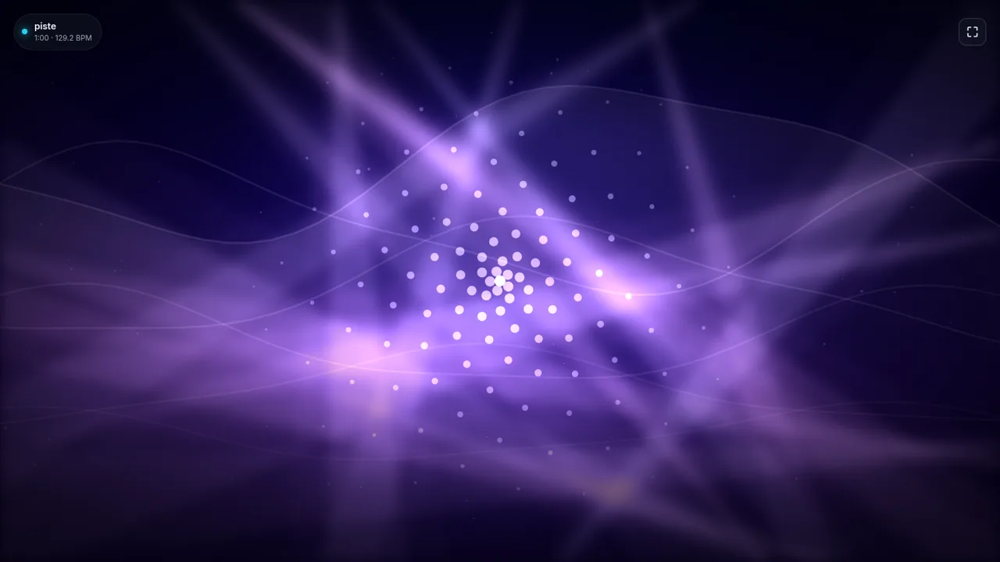
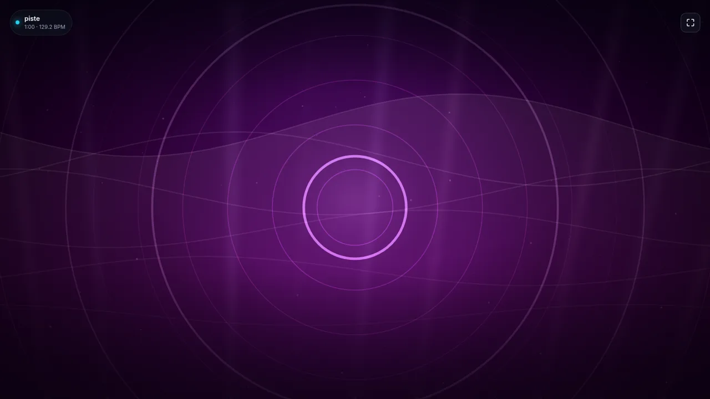
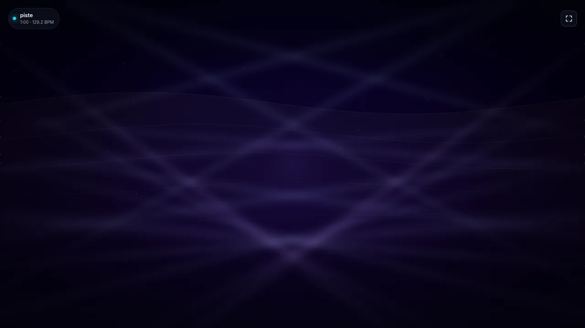

# Night Light — light show musical

[](https://github.com/MattiaPARRINELLO/night-light-v2/actions/workflows/ci.yml)
[](./LICENSE)

Application **personnelle** (une seule personne, aucune authentification) : tu déposes un
morceau, le serveur l'analyse avec librosa, et le navigateur joue un spectacle lumineux
synchronisé sur la musique.





```
morceau (glisser-déposer)
   → serveur Python : décodage, bandes, tempo, temps forts, sections, montées, structure (couplet/refrain)
   → interface (Canvas 2D) : faisceaux, tunnel, particules, vagues, grille, anneaux
        pilotés par la position réelle de lecture (audio.currentTime)
```

Ce n'est **pas** un visualiseur qui réagit au volume : tout le spectacle est calculé à
partir de l'analyse, et l'image est une fonction du temps musical. Après une pause, une
reprise ou un retour en arrière, le spectacle reprend exactement là où la musique en est.

---

## Démarrer

```bash
bun install            # dépendances de l'interface (Vite)
bun run dev            # API + interface via Portless → https://nightlight.localhost
```

`bun run dev` lance deux processus :

- l'API d'analyse (`uvicorn`, **127.0.0.1 uniquement** — elle n'est pas exposée sur le réseau) ;
- l'interface (`vite`) publiée par Portless sur `https://nightlight.localhost`, qui relaie `/api` vers l'API.

Sans Portless : `bun run api` (API) et `bunx vite` (interface) séparément, puis ouvrir
l'adresse affichée par Vite.

Pour ne lancer que l'API (par exemple derrière un proxy existant), `bun run api` démarre
`uvicorn` sur `127.0.0.1:8787`. Les autres réglages (`DEEZER_ARL`, limites, chemins…) se
lisent dans l'environnement, à définir dans ton shell ou via un `.env` sourcé par lui.

## Utiliser

1. Ouvre l'application : plein écran, zone **« Dépose ta musique ici »** (glisser-déposer
   ou bouton « Choisir un fichier »).
2. Formats acceptés : **MP3, WAV, OGG, FLAC, M4A/AAC, AIFF, WebM** — vérifiés d'après les
   octets du fichier, pas d'après son extension (un MP3 renommé `.wav` est reconnu comme MP3).
3. L'écran d'analyse affiche le nom, la durée, la progression réelle (envoi puis phases
   d'analyse) et, à la fin, le bouton **« Lancer le show »**.
4. Pendant le show : lecture/pause (`Espace`), recommencer (`R`), plein écran (`F`),
   volume (`↑`/`↓`), position (`←`/`→`), intensité, flashs, intensité réduite, sans flashs,
   retour à l'écran de dépôt.
5. Tu peux relancer le show autant de fois que tu veux : tant que la session vit, l'analyse
   et le fichier audio sont gardés côté serveur, il n'y a rien à recalculer.

## Récupérer un morceau par son titre (Deezer)

Un morceau peut aussi être retrouvé sans dépôt de fichier : l'API (`POST /api/resolve`)
résout un couple titre/artiste, et le lecteur en cours peut être suivi automatiquement
(MPRIS).

La recherche se fait **dans le catalogue Deezer**, par titre et artiste — pas dans des
clips vidéo — et le morceau est téléchargé **en 128 kbps MP3**, le plus bas niveau de
qualité proposé, choisi délibérément : l'analyse et la lecture ne justifient pas plus
lourd. Le morceau récupéré est ensuite mis en cache comme un fichier déposé.

Prérequis :

1. **streamrip** — le CLI qui cherche et télécharge. C'est le fork maintenu
   ([Stensel8/streamrip](https://github.com/Stensel8/streamrip), Python ≥ 3.14), installé
   à côté du projet : le serveur l'appelle en sous-processus.

   ```bash
   git clone https://github.com/Stensel8/streamrip ~/.local/share/night-light/streamrip
   uv tool install ~/.local/share/night-light/streamrip
   ```

   > streamrip exige **Python ≥ 3.14** ; le serveur d'analyse, lui, tourne sur
   > **Python 3.11 à 3.13** (voir `pyproject.toml`). Les deux environnements sont
   > indépendants.

2. **Le cookie ARL de ta session Deezer**, dans `DEEZER_ARL` (voir `.env.example`). Il se
   lit dans les cookies du navigateur connecté à Deezer : DevTools → Application →
   Cookies → `arl`. Sans lui, la récupération est refusée avec un message explicite, et le
   reste de l'application fonctionne normalement.

> ⚠️ **Avertissement.** Cette récupération télécharge des morceaux depuis Deezer en
> s'appuyant sur une session personnelle, ce qui est contraire aux conditions
> d'utilisation de Deezer et peut poser un problème de droits. La fonctionnalité est
> **désactivée tant que `DEEZER_ARL` est vide** et n'a de sens que dans un cadre
> strictement privé. Pour un usage partagé, préfère le dépôt de fichiers locaux.

Le provider (`server/retrieve/deezer.py`) n'appelle que le CLI : il écrit pour streamrip une
copie privée (`0600`) de sa configuration dans le répertoire de cache, y pose le cookie et
force le niveau de qualité le plus bas. Aucun secret n'est écrit dans le dépôt.

## Confidentialité et sécurité

- Le fichier part de ton navigateur vers **ton serveur local**, et c'est indiqué sur
  l'écran de dépôt.
- Aucun fichier audio n'est jamais servi publiquement : il faut connaître l'identifiant de
  session, il est supprimé quand tu changes de morceau, à la fermeture du serveur, et au
  bout de `SESSION_TTL_SEC` (30 min) sans activité.
- Seules les **données d'analyse** sont conservées en mémoire pour le rejeu ; le fichier
  lui-même n'est gardé que le temps de la lecture, puis effacé.
- Le répertoire des sessions doit s'appeler `night-light-sessions` : c'est une garde
  explicite contre une purge qui effacerait autre chose (voir `server/store.py`).
- Serveur : limite de taille (`MAX_FILE_MB`), de durée (`MAX_DURATION_SEC`), délai d'analyse
  (`ANALYZE_TIMEOUT_SEC`), nombre d'analyses simultanées, vérification du type réel,
  sessions dans un répertoire dédié. Aucune clé ni mot de passe dans le code : tout se règle
  par variables d'environnement (voir `.env.example`). Le cookie Deezer `DEEZER_ARL` n'est
  ni versionné ni journalisé : il n'est recopié que dans la configuration privée (`0600`)
  que streamrip utilise, dans le répertoire de cache.

**N'expose pas ce serveur à Internet** : il n'a pas d'authentification. Il
**refuse de démarrer** sur une adresse non locale (`HOST=0.0.0.0` par exemple) ;
il faut lever explicitement ce garde-fou avec `ALLOW_NETWORK=1`.

## Ce que l'analyse produit

Réellement calculé par librosa sur les échantillons décodés (22 050 Hz, STFT 2048/hop 512) :

| donnée | méthode |
| --- | --- |
| tempo, temps forts | `onset_strength` + `beat_track` (recherche de phase) |
| attaques | `onset_detect`, corrigé du retard de groupe de la STFT |
| basses / médiums / aigus | énergie des bandes 30–150, 150–2000, 2000–10 000 Hz, lissée puis normalisée |
| énergie globale | RMS + bandes, normalisation logarithmique (reste lisible dans les passages modérés) |
| sections | regroupement agglomératif de MFCC + chroma, puis étiquetage calme/montée/intense/descente/silence |
| structure (couplet/refrain) | chroma + MFCC agrégés par temps fort, regroupement agglomératif, puis rapprochement des sections au matériau proche (groupe A, B…) |
| montées | dérivée de la courbe d'énergie, filtrée sur l'amplitude gagnée |

Toutes les courbes sont envoyées en points `[secondes, 0..1]` à 20 Hz — compacts et
directement échantillonnables depuis le navigateur.

### Limites connues

- **M4A/AAC** : libsndfile ne les ouvre pas toujours ; le serveur les décode alors via
  `ffmpeg`. Si `ffmpeg` est absent, ces formats sont refusés avec un message clair.
- **Tempo** : la détection de battement reste une estimation. Sur des morceaux sans
  percussion marquée (ambient), elle peut désigner la moitié ou le double du tempo ressenti.
  Le spectacle s'appuie donc aussi sur les courbes d'énergie et de bandes, pas seulement sur
  les temps forts.
- **Sections et structure** : un regroupement automatique, pas une annotation musicale. Les
  groupes « couplet / refrain » sont déduits de la similarité du matériau (harmonie + timbre)
  entre sections : c'est une lecture plausible et stable, pas une vérité d'annotation.
- La lecture dans le navigateur dépend des codecs du navigateur : si un morceau analysé
  n'est pas lisible, l'application le dit et propose un format plus sûr (WAV, MP3).
- **Récupération Deezer** : la recherche de streamrip ne renvoie pas la durée d'un
  résultat. La durée est donc vérifiée sur le fichier téléchargé (`ffprobe`, tolérance
  0,5 %) : un écart franc écarte le candidat au lieu d'accepter une autre version (live,
  remix, edit).

## Le spectacle

Vingt-huit familles visuelles tournantes. Les projecteurs se déclinent en figures de
concert : faisceaux, projecteurs, miroirs, défilé, tirs croisés, rideau de lumière,
rayonnement, formes projetées, pendules, couronne, pluie de lumière, portique, étoile,
vortex, lyres, lyres suspendues, barres LED, pont concert. Les autres jouent sur la
matière et la géométrie : tunnel, particules, vagues, grille, anneaux, volets, barres,
spirale, rosace, treillis.

Quelques figures méritent un mot, parce qu'elles ont une intention :

| famille | ce qu'elle raconte |
| --- | --- |
| **pendules** | une rangée de têtes sur un portique, la vague traverse la rangée au lieu de tout basculer d'un bloc |
| **couronne** | des têtes posées sur un arc, leurs rayons s'élancent vers le haut comme une tiare, la lumière en fait le tour |
| **faisceaux** | deux éventails jumeaux partant chacun d'un point visible — l'un au plancher, l'autre au plafond ; les deux côtés s'allument ensemble ou l'un sans l'autre |
| **pluie de lumière** | des colonnes tombent du plafond, chacune avec son cycle et sa longueur |
| **portique** | une porte de lumière qui s'ouvre sur les moments forts et se referme sur les passages calmes |
| **étoile** | un projecteur rotatif : peu de branches, un foyer qui dérive, chaque branche pulsant à son tour |
| **vortex** | un éventail vrillé dont la vrille se resserre avec l'énergie |
| **formes projetées** | des gobos (cercle, anneau, losange, triangle) répartis dans tout le cadre ; quand elles sont nombreuses, une ou deux basculent sur la couleur opposée au lieu de se déplacer |
| **lyres** | une rangée de têtes fines au sol, la vague traverse la rangée par décalage de phase — chacune s'incline tour à tour |
| **lyres suspendues** | huit têtes accrochées au pont technique, ballyhoo en refrain, éventail en montée et convergence au sol sur un impact |
| **barres LED** | seize lames très serrées sur leur traverse : onde d'inclinaison progressive en couplet, rideau parallèle en refrain et en drop |
| **pont concert** | le plateau complet, lyres et barres ensemble, déployé sur les impacts |
| **rosace** | huit pétales en V répartis au tour, un hexagone et un triangle qui tournent en sens contraires |
| **treillis** | deux nappes de faisceaux parallèles croisées en losanges, une grille lente qui s'écarte sur les temps forts |

### La scène

Le spectacle se joue désormais sur un plateau : un pont en treillis à 12-16 % de la
hauteur, une seconde traverse pour les barres LED, deux totems latéraux et quatre blocs
de blinders tungstène. La structure est permanente ; seuls les faisceaux changent de
figure.

Les blinders ne s'éteignent pas d'un coup : leur filament suit `exp(-Δt / 0,22 s)`, puis
passe du blanc chaud à l'ambre et au rouge avant de tomber au noir. Au-dessus de 0,6
d'intensité, un flare anamorphique étire le halo horizontalement.

Trois échelles de renouvellement se superposent, pour que l'écran ne tourne jamais en
boucle :

| échelle | durée | ce qui change |
| --- | --- | --- |
| **phrase** | 5-8 s | famille principale, palette, humeur (calme / pulsé / explosif / aérien / sombre) |
| **variation** | milieu de chaque phrase | une seconde famille surgit brièvement, avec sa propre teinte |
| **dérive** | en continu | la teinte glisse lentement (0,4°/s) et respire de ±14° autour de celle de la scène |

### Rien n'apparaît ni ne disparaît d'un coup

Trois règles, toutes vérifiées par des tests :

- **les mouvements sont calés sur le tempo** (`beatSwing`) : la cible change à chaque pas,
  l'interpolation arrive sur les 70 % du pas puis tient — le projecteur se réoriente *sur* le
  temps fort et reste en place le reste du temps ;
- **chaque élément s'allume et s'éteint progressivement** (`elementEnvelope`) : montée
  lissée, maintien, extinction lissée, jamais de saut. Le cycle se compte en temps forts et
  chaque élément a son décalage, donc ils s'allument l'un après l'autre ;
- **la couche de fond est commune à tout le morceau** (`plan.backdrop`) : c'est l'élément qui
  reste à l'écran quand tout le reste change. Avec le fond, le halo et la poussière — qui ne
  dépendent plus du fondu de scène — l'écran ne passe jamais par le noir entre deux scènes.

L'ampleur d'un balayage et la cadence des allumages suivent l'énergie : un couplet se
contente d'un mouvement étroit et lent, un refrain ouvre largement et vit plus vite.

### Des faisceaux diffus

Les projecteurs ne dessinent pas des triangles aux arêtes nettes : `softBeam` donne à
chaque faisceau un bord fondu, comme de la lumière dans la fumée d'une salle.

Le flou n'est pas appliqué sur place, faisceau par faisceau : il passe par une **surface de
fumée**. Les faisceaux y sont déposés en basse résolution, la surface est floutée **une seule
fois** par image, puis remontée — l'agrandissement finit d'adoucir les bords. C'est ce qui
rend la diffusion tenable : un `ctx.filter` s'applique à toute la surface couverte, et chaque
appel coûte en pratique une passe pleine toile. Vingt projecteurs allumés ensemble, c'était
donc vingt passes pleine toile par image affichée — mesuré à **2 images par seconde**, contre
**40** avec la surface de fumée, sur la même scène et à qualité égale.

Le rayon du flou suit la taille de l'écran (5 à 16 px) : le même spectacle est aussi diffusé
sur une télévision que sur un mur de projection. Il ne s'éteint **jamais** — même sur une
machine qui souffle, où seule la résolution de la surface baisse. À défaut de surface
(navigateur sans toile, mode réduit), le profil est approché par superposition de couches
(`beamLayers`).

### La couleur

Le spectacle éclaire une salle de soirée : les teintes sont franches, et **chaque morceau a
sa palette**, choisie une fois d'après le morceau lui-même et tenue du premier au dernier
plan (`plan.track`). Elle se compose d'une teinte principale et d'une complémentaire :

- chaque scène reste dans la fenêtre de l'une ou de l'autre ;
- les **moments forts basculent sur la complémentaire** — c'est le saut de couleur qui marque
  un refrain ou un drop ;
- dès qu'une scène a plusieurs sources, ses projecteurs ne sont pas monochromes : ils se
  répartissent sur un **accord** tiré du cercle chromatique (`lampHue`). Quatre accords
  alternent d'une scène à l'autre — demi-complémentaire, triade, carré, hexade — et l'accent
  du morceau remplace toujours son 180 : la scène est multicolore, mais ses couleurs viennent
  toutes de la palette du morceau. Les lampes parcourent l'accord avec un pas qui ne retombe
  jamais sur la voisine, donc une rangée se lit comme un dégradé d'univers, pas comme deux
  tons alternés ;
- quand les formes projetées sont nombreuses, **une ou deux basculent brièvement sur la couleur
  opposée** (`colorFlip`) : le passage à l'opposée est une rotation de la roue de couleurs, donc
  progressif — c'est le déplacement remplacé par la couleur, là où un motif de plus ne se lirait
  pas ;
- l'éclairage suit l'humeur : explosif à 0,96 de saturation et 0,76 de luminosité — près du
  blanc, c'est ce qui « allume la salle » — contre 0,62 / 0,44 pour les passages calmes, afin
  que l'impact se voie ;
- les sauts de teinte à l'impact sont bornés à 32° : la lumière change, la palette tient.

### La transition

Le passage du direct au show programmé (et le retour) n'est pas une coupure : l'image s'ouvre
depuis le noir avec un front lumineux qui balaie l'écran, sur environ 1,5 s.

Deux couches sont visibles en permanence : la famille de la phrase et une couche de fond
discrète, de sorte qu'une image montre toujours deux mondes superposés.

**Réactions aux moments forts** :

- **drop** : quand une montée se résout sur l'impact, saut de teinte (70°), wash complet de
  seize projecteurs et lavage blanc pendant ~2,5 s ;
- **montée d'énergie** : quand le morceau prend de l'ampleur, l'intensité augmente et le
  spectacle pulse sur les temps forts ;
- **temps forts** : flashs cadencés, pulsations du noyau lumineux, ondes des anneaux.

Tout cela est plafonné : un flash ne dépasse jamais 40 % d'opacité, deux flashs sont
séparés d'au moins 0,14 s, et le mode réduit supprime les flashs, le wash de drop
et les variations.

**Synchronisation** : chaque image est rendue à partir de `audio.currentTime`. Aucun état
n'accumule de dérive, donc la position du spectacle est toujours juste, y compris après
seek. La qualité s'adapte d'elle-même (nombre d'éléments réduit sous 52 fps).

**Confort visuel** :

- mode « intensité réduite » (moins d'éléments, mouvements ralentis, aucun flash) ;
- curseur de flashs réglable de 0 à 150 %, avec un plafond d'opacité et un espacement
  minimal entre deux flashs ;
- `prefers-reduced-motion` du système est respecté et active automatiquement le mode réduit ;
- deux teintes voisines sont toujours séparées d'au moins ~34°, pour éviter les alternances
  de couleur agressives ;
- les flashs sont suffisamment espacés pour ne pas former de stroboscope ; ce n'est pas une
  garantie, et le mieux reste de les couper si tu y es sensible.

## Vérifier

```bash
bun run lint            # oxlint (front) + ruff (serveur)
bun run typecheck       # types (tsc)
bun run test            # types + tests front + tests serveur
bun run build           # build de production dans dist/
bun run check:browser   # parcours complet dans un vrai navigateur (Playwright)
bun run check:sync      # synchronisation Show ↔ lecteur, sans lecteur réel
bun run check:dashboard # écran de show + dashboard, de bout en bout
```

Les vérifications navigateur (`check:*`) exigent un environnement préparé :

```bash
uv sync                                 # crée .venv (le serveur est lancé via .venv/bin/uvicorn)
bun add -D playwright                   # client Playwright
bunx playwright install chromium        # navigateur
bun run build                           # l'API sert dist/ pour ce type de test
```

Les tests couvrent le cœur pur (courbes, scènes, couleurs, rendu déterministe), le serveur
(détection de format, limites, cycle d'analyse, suppression de session) et un parcours
navigateur réel : dépôt, analyse, lancement, pause/reprise, mode réduit, redémarrage, retour
au dépôt, absence d'erreur console.

### Tester la synchronisation sans lecteur réel

`bun run check:sync` fabrique un faux `playerctl` (`tests/support/fake_playerctl.py`, piloté par
`tests/support/fake_player.py`) qui joue un morceau de 12 s dont on choisit la position et le titre.
Le serveur est lancé avec ce faux binaire en tête de `PATH`, puis le test dépose le fichier
correspondant et vérifie, via l'overlay de debug :

1. que le show démarre à la position du lecteur (écart mesuré, pas une fourchette) ;
2. qu'un **recul** de 5 s est suivi par le show ;
3. qu'une **avance** de 5 s est suivie aussi ;
4. qu'un changement de morceau ramène en Live ;
5. que l'écart résiduel après recadrage reste sous 300 ms.

Deux régressions sont couvertes par ces tests :

- **l'horloge** : la position du lecteur doit être extrapolée avec `Date.now()` (epoch,
  comme le serveur), jamais `performance.now()`. Mélanger les deux ramenait la position à
  0 et rebouclait le show sur la même scène ;
- **la latence de lecture** : `playerctl` met du temps à répondre, donc le serveur
  horodate la position au milieu du sous-processus (`position_read_at`) au lieu de la fin
  de tous les appels. Sans ça, le show perdait à chaque resync la durée de lecture du
  binaire (~0,5 s avec un faux lent).


## Structure

```
index.html              écran de show : la toile, rien d'autre
dashboard.html          tableau de bord : tout ce qui se règle et se lit
src/
  main.ts               démarrage
  types.ts              schéma de l'analyse et réglages de rendu
  core/
    series.ts           échantillonnage et aides numériques (purs)
    view.ts             accès à l'état musical à un instant donné
    show.ts             composition des scènes (palettes, familles)
    families/           les vingt-huit familles d'effets
      concert-rig.ts    structure, lyres, barres LED et blinders
    render.ts           rendu d'une image complète
    color.ts            HSL → RGB
    api.ts              client HTTP de l'API
    nowPlaying.ts       détection du morceau joué par un lecteur externe (pur)
    liveAudio.ts        caractéristiques audio live (normalisation, lissage)
    playback.ts         position du lecteur, dérive, corrélation (purs)
    debug.ts            journal de debug partagé (console + overlay)
  shared/
    control.ts          protocole show ↔ dashboard (BroadcastChannel)
  browser/
    app.ts              orchestration (dépôt, analyse, show, raccourcis)
    audio.ts            lecture et position musicale
    ui.ts               accès DOM
  styles/               base, dépôt, commandes
server/
  config.py             réglages lus dans l'environnement
  sniff.py              détection du format réel par octets
  analysis.py           moteur librosa (décodage, courbes, rythme, sections, montées)
  structure.py          groupes couplet/refrain (chroma + MFCC par temps fort)
  store.py              sessions et travaux d'analyse
  main.py               API FastAPI
  retrieve/             récupération d'un morceau : provider Deezer (streamrip), cache, validation
tests/                  tests front & serveur (unit/), vérification navigateur (e2e/),
                        faux lecteur et fixtures (support/)
scripts/                démarrage dev et lancement des tests
src/dashboard/          tableau de bord (page + styles)
```

## Variables d'environnement

| variable | défaut | rôle |
| --- | --- | --- |
| `SESSION_DIR` | `/tmp/night-light-sessions` | répertoire des sessions (fichiers audio de lecture) |
| `CACHE_DIR` | `~/.local/share/night-light/cache` | cache persistant des morceaux récupérés (survit au redémarrage) |
| `MAX_FILE_MB` | `40` | taille d'envoi maximale |
| `MAX_DURATION_SEC` | `900` | durée de morceau maximale |
| `ANALYZE_TIMEOUT_SEC` | `240` | délai d'analyse |
| `SESSION_TTL_SEC` | `1800` | durée de vie d'une session inactive |
| `DEEZER_ARL` | *(vide)* | cookie ARL Deezer pour la récupération d'un morceau (vide : récupération désactivée) |
| `API_PORT` | `8787` | port de l'API |
| `WEB_PORT` | `5173` | port de l'interface |
| `ALLOW_NETWORK` | *(vide)* | lève le refus de démarrer sur une adresse non locale (voir Sécurité) |

## Le tableau de bord (`/dashboard`)

Deux pages, deux rôles. L'écran de show (`/`) n'est plus qu'une toile ; tout ce qui se lit et
se règle vit sur `/dashboard`, ouvert sur un autre écran :

```bash
bun run dev        # puis http://localhost:5173/dashboard (voir WEB_PORT)
```

| Sur l'écran de show | Sur le dashboard |
| --- | --- |
| le canvas, en plein écran | mode, capture, positions, écart au son |
| aucun bouton, aucun panneau | spectre live, niveaux, courbes de 60 s |
| raccourcis `D` `S` `Échap` `F` | dépôt de fichier, recherche par titre |
| | intensité, flashs, réduit, sans flashs |
| | latence (+ presets filaire / Bluetooth, calage) |
| | forcer Live / Show, couper la capture, overlay |

### Comment les deux pages se parlent

`BroadcastChannel` sur l'origine courante (`src/shared/control.ts`) :

- le show **publie** son état complet 5 fois par seconde ;
- le dashboard **envoie** des commandes (`set-latency`, `set-settings`, `capture`,
  `force-live`, `force-show`, `debug-overlay`, `analysis-ready`…).

Aucun état sur le serveur, aucun rechargement : deux onglets du même navigateur suffisent, sur
deux écrans. Le protocole est versionné — deux versions différentes s'ignorent au lieu de se
comprendre de travers.

Le dashboard fait lui-même l'analyse : il dépose ou résout le morceau, puis transmet l'analyse
à l'écran de show, qui se charge du calage sur le lecteur. Le fichier audio ne traverse donc
jamais le canal.

### L'écran de show sait vivre seul

Tant qu'aucun dashboard ne lui parle, `/` reste une application normale (dépôt, analyse,
show) : les tests et l'usage à un seul écran continuent de fonctionner. Dès qu'un dashboard se
manifeste, la classe `kiosk` masque toute l'interface ; si le dashboard disparaît plus de 3 s,
elle est retirée et l'écran redevient utilisable. Pas de piège de l'écran noir.

## Synchronisation Show / lecture externe

### Prérequis pour la position de lecture

Le show automatiquement synchronisé utilise **MPRIS** pour connaître le morceau en cours
et la position du lecteur. Options :

1. **playerctl** (recommandé, le serveur l'utilise comme repli), installé sur le système.
2. **Un lecteur MPRIS compatible** (Spotify, VLC, MPD avec `mpd-mpris`, navigateurs Chromium
   modernes sous Linux…).

```bash
# Debian/Ubuntu
pkexec apt install playerctl
```

Si aucune position n'est disponible, Night Light bascule automatiquement sur un repli par
corrélation d'énergie (tour de garde supplémentaire), puis revient en mode Live si le score
est insuffisant.

### Calage de la latence Offline

Dans le dock **Analyse**, le réglage **Latence (ms)** (-500 à +1000, pas de 10 ms) compense
la différence entre le signal audio et le rendu visuel :

- **Filaire** : preset 0 ms.
- **Bluetooth** : preset +200 ms.
- **Bouton « Caler »** : pendant un show synchronisé, tape quand tu entendes le beat ; la
  valeur s'ajuste approximativement. Deux taps supplémentaires affineraient en production.

Valeurs sont persistées dans `localStorage` (`night-light-latency`).

### Pourquoi certains morceaux n'ont presque pas de drops

Les drops viennent des **montées** de l'analyse : `server/analysis.py` (`detect_builds`) valide une
montée seulement si elle gagne **≥ 18 %** d'énergie sur **≥ 2 s**. Un morceau fort d'un bout à
l'autre — rap masterisé, electro compressée — ne contient presque aucune montée, donc aucun
drop : le spectacle ne vivait plus que sur les changements de scène.

Deux conséquences, et un réglage :

- ce n'est **pas** un problème de synchronisation ni d'encodage (vérifié : WAV, MP3 128 kbps et
  FLAC donnent exactement les mêmes montées) ;
- le log d'analyse affiche le chiffre (`analyse terminée {..., temps: 394, montees: 1, ...}`) ;
- **pulsage de secours** : quand l'analyse trouve **2 montées ou moins**, le rendu pulse sur les
  temps forts eux-mêmes (`beatDrive` dans `src/core/render.ts`), à 60 % de l'intensité d'un vrai
  drop et dosé par l'énergie locale. Un morceau dynamique ne voit rien changer, un morceau plat
  respire au rythme du beat.

### Pourquoi le show ne s'éteint jamais

L'analyse normalise l'énergie en échelle logarithmique — le 10e centile tombe à 0
— ce qui écrase les couplets. Un passage audible se retrouvait à 0,05, et comme
l'alpha de chaque famille vaut `0,05 + 0,32 × énergie`, l'écran devenait **noir en
pleine musique**.

Le rendu pose donc un plancher visuel (`ENERGY_FLOOR = 0.26`, `visibleEnergy`)
exclusivement sur ce qu'il dessine, jamais sur les données d'analyse : un couplet
reste plus calme qu'un refrain (0,26 contre 0,95 d'énergie) mais rien ne
disparaît. Les gardes de montées, de sections et de drops continuent de voir
l'énergie réelle.

### Modération des flashs
Trop de flashs fatiguent une salle autant qu'un écran. Deux gardes, toutes deux des fonctions
pures du temps musical (donc déterministes : après une pause ou un saut, la même image sort) :

- **cadence** (`FLASH_MIN_GAP = 1.6 s`) : un flash de temps fort sur `n` seulement, `n` étant
  calculé pour que l'intervalle dépasse toujours 1,6 s — 4 temps forts à 130 BPM, 2 à 60 BPM ;
- **lavage blanc** : seul un vrai drop de l'analyse blanchit l'écran. Le pulsage de secours
  éclaire la scène, il ne flashe jamais plein écran.

Un drop de montée garde sa priorité sur la cadence : il est rare, et c'est justement le moment
que le spectacle doit montrer.

### Des pulses en accord avec la musique

Trop de pulses fatiguent, mais les supprimer partout appauvrit le show. Le vrai réglage est de
**ne célébrer que les temps forts qui portent quelque chose** : `beatStrength` (dans
`src/core/render.ts`) croise trois informations de l'analyse —

- le temps fort lui-même (`beatPulse`) ;
- la bande **30-150 Hz** à cet instant : pas de basse, pas de pulse. Une charley ou un temps
  mort ne déclenche plus rien ;
- l'énergie du passage et celle de la section.

Résultat : fort sur un kick dans un passage soutenu, quasi muet dans un couplet calme, et
strictement rien sur un temps fort sans basse. Tout ce qui pilote l'image (familles, flashs,
montées, intensité) passe par cette valeur, donc le show respire avec la musique au lieu de la
couvrir.

### Overlay de debug

Touche **D** affiche / masque l'overlay avec : mode actif, source de position, position show,
latence appliquée et état de la capture.

## Debug : voir ce qu'il se passe en direct

Deux sorties complémentaires, pensées pour diagnostiquer une soirée sans deviner.

### Overlay à l'écran — touche `D`

Affiche et masque un panneau en haut à droite. Il se rafraîchit deux fois par
seconde et contient :

| Ligne | Contenu |
| --- | --- |
| `mode` | `LIVE`, `SYNCING`, `SHOW_SYNCED`, `SHOW_LOCAL`, `PAUSED`, `LOST` |
| `capture` | état du flux SSE (`ouvert`, `fermé`, `erreur`), nombre de messages reçus, débit en messages/s, âge du dernier message |
| `capture état` | état remonté par `parec` (`active`, `silent`, `error`), moniteur audio utilisé, erreur éventuelle |
| `audio brut` | `rms`, énergie, basses, médiums, aigus, transitoire tels que reçus du serveur |
| `audio lissé` | les mêmes valeurs après lissage exponentiel |
| `rendu live` / `rendu show` | fps mesurés, palier de qualité, nombre d'images |
| `sync …` | source, morceau attendu vs morceau lu, position lecteur, position show, écart en ms, latence appliquée, tentatives, verdict |
| `journal` | les derniers événements horodatés |

Le journal limite les lignes de routine (valeurs qui se répètent) à six pour que
les vrais événements — changement de morceau, recalage, erreur — restent lisibles.

### Console du navigateur

Chaque événement écrit une ligne horodatée et catégorisée :

```
[live]    11:04:10.212 mode live démarré · capture du son du PC ouverte
[capture] 11:04:10.270 état de la capture → active {"source":"…monitor","rms":"0.0000"}
[analyse] 11:04:10.403 phase « En file d'attente » {"progression":"0 %"}
[sync]    11:04:10.273 lecteur scruté {"source":"détecté","titre":"Karma","ambigue":false}
[sync]    11:04:29.350 écart important · recalage direct du show {"ecartMs":1810}
[ERREUR]  11:04:30.001 position de lecture injoignable pendant la resynchronisation
```

Catégories : `boot`, `capture`, `analyse`, `sync`, `live`, `show`, `ERREUR`.
Les valeurs qui se répètent (caractéristiques audio, resynchronisations OK,
scrutation du lecteur) sont naturellement espacées dans le temps pour ne pas
noyer la console.

Les valeurs de l'overlay et les lignes de console sont écrites par
[`src/core/debug.ts`](./src/core/debug.ts) (`dbgLog`, `dbgThrottled`).

## Licence

[MIT](./LICENSE).
